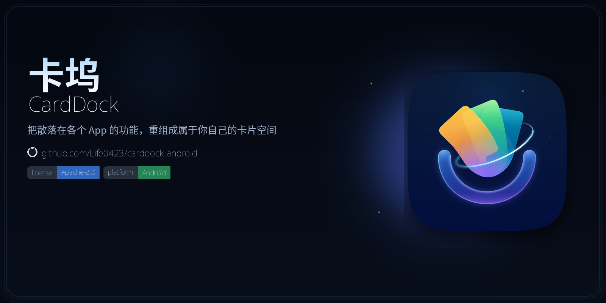

<p align="center">
  
</p>

# 卡坞 · CardDock

把散落在各个 App 的功能，重组成属于你自己的卡片空间。

[](LICENSE)
[](https://developer.android.com/about/versions/oreo/android-8.0)
[](https://github.com/Life0423/carddock-android)

开源、不上架、不收费。根目录的 `0.1.0-prototype` 使用本地模拟设备。它把需求转成可检查的规则，先试运行、再保存到个人空间，后续刷新直接执行已保存的规则。

团队主线为根目录 `app → core`，后续真机能力逐项接入这套架构。独立真机实验参考位于 `experiments/mika-android/`。原分支记录在 vivo 上验证了菜鸟待取空状态、美团历史订单、京东 A/B 卡片、选购任务恢复和模型生成菜鸟规则。运行入口及价格核验边界见[真机原型说明](experiments/README.md)。成员协作以 [分支归并与架构说明](docs/INTEGRATION.md) 为准。

长远目标是由 Agent 记住你常用的功能和中断的地方，帮你直达功能、接着办完（当前原型尚未实现）。

## 主工程可以体验什么

- 空间：预置两张待刷新功能卡，显示内容、执行状态和上次成功时间。
- 模板：取件、配送、出行三种通用示例。
- 创建：输入需求 → 匹配演示模板 → 试运行 → 核验预览 → 修改名称 → 明确确认保存。
- 刷新：复用已保存规则，成功后更新快照。失败、取消、对象不匹配或需要接管时保留上次有效结果。
- 我的：切换正常获取、需要接管、读取失败、对象不匹配四种模拟场景。
- 接管：点击完成模拟接管后重新读取并核验；不会直接把旧结果标为成功。
- 本地保存：卡片和最近一次运行状态保存在应用私有目录；重启后恢复。
- 移除与重置：均由用户明确触发，界面提供确认。

原型只实现一个“日常空间”。每张卡保存最近一次运行信息，不提供完整历史、自动刷新或后台调度。

## 运行主工程

### Android Studio

1. 解压整个工程，在 Android Studio 中打开本目录。
2. 为 Gradle 选择 JDK 17，安装 Android SDK Platform 35。
3. 等待 Gradle 同步完成，选择 `app` 的 `debug` 变体。
4. 在 Android 8.0 / API 26 或更高版本的设备、模拟器上运行。

工程包含标准 Gradle Wrapper，首次构建需要下载工具链依赖。

### 命令行

安装 JDK 17 和 Android SDK，设置 `JAVA_HOME`、`ANDROID_HOME`，或在本地 `local.properties` 配置 `sdk.dir`。

```bash
./gradlew :core:test :app:testDebugUnitTest :app:lintDebug :app:assembleDebug
```

Windows 使用 `gradlew.bat`。APK 输出：

```text
app/build/outputs/apk/debug/app-debug.apk
```

连接设备后可安装：

```bash
adb install -r app/build/outputs/apk/debug/app-debug.apk
```

这条命令需要已连接并授权的设备。没有设备时会失败。

代码 namespace 和基础 applicationId 为 `com.life0423.carddock`。调试版本增加 `.prototype` 后缀，实际安装包为 `com.life0423.carddock.prototype`，桌面名称为“卡坞 · 原型”，方便与之后的正式应用共存。

## 三分钟体验路径

1. 打开空间，点击“待取快递”的“刷新卡片”，查看演示取件信息及成功时间。
2. 在“模板”中选择一种模板，点击“试用这个模板”，试运行后确认保存。
3. 到“我的”把场景切换为“读取失败”，返回空间刷新已有有效结果的卡片：旧内容和旧成功时间应保留，并出现失败状态。
4. 将场景切换为“需要接管”，刷新后点击“完成模拟接管”：会发起一次新的核验。
5. 在刷新过程中点击取消，或者在试运行时关闭创建窗口，观察任务停止。
6. 关闭并重新打开应用，确认保存的卡片仍在。若上次运行在进程结束时尚未完成，会标记“已中断”，需要主动重新运行。

## 工程结构与修改入口

主工程包含两个 Gradle 模块。`experiments/mika-android` 是独立参考工程，不是第三个模块，也不是团队的第二条产品主线。

| 位置 | 职责 | 通常何时修改 |
| --- | --- | --- |
| `core/model` | 卡片、快照、模板、运行记录 | 数据结构变化 |
| `core/port` | `DeviceGateway`、`RuleCompiler`、`CardStore` 接口 | 能力边界变化 |
| `core/rule` | 版本化规则与静态验证 | 规则语言变化 |
| `core/engine` | 校验目标、读取字段、产生结果 | 执行语义变化 |
| `core/session` | 卡片集合、运行队列、创建草稿与状态协调 | 业务流程变化 |
| `app/demo` | 通用模板、模拟设备和演示情景 | 新增或调整演示内容 |
| `app/ai` | 明确标记的 Mock 编译器 | 替换需求编译实现 |
| `app/data` | 原子文件持久化 | 替换数据库或增加迁移 |
| `app/ui` | 无状态 Compose 界面、组件和主题 | 页面、布局、配色调整 |
| `app/AppContainer.kt` | 手写依赖装配 | 切换真实实现或测试实现 |

`core` 是纯 Kotlin/JVM 模块，不引用 Android、Compose、Context、Activity 或设备权限。依赖方向只有 `app → core`。

`CardDockApp(state, actions)` 只接收状态和回调，界面重组不会启动设备任务。`CardDockViewModel` 负责绑定，应用级 `PrototypeController` 协调持久化、创建和运行。它的动作在同一调度器调用；界面场景使用主线程，测试使用可控制的测试调度器。

详见 [架构决策](docs/decisions/0001-prototype-boundaries.md) 和 [维护与接入](docs/maintenance.md)。

## 已坚持的行为约束

- **先校验整份规则，再读取设备。** 未知 schema、非法步骤顺序、重复输出键和无效必填引用会被拒绝。
- **核对来源和目标。** 不把其他对象的字段当作这张卡的内容。
- **只有核验成功才更新内容和成功时间。** 执行失败与快照失效是不同状态。
- **同一张卡的重复刷新不重复启动。** 不同卡片与创建试运行共用一个串行设备通道。
- **取消继续传播。** 不将取消异常当成一次普通失败，也不自动重试。
- **编辑需求使预览失效。** 必须重新试运行才能保存；修改标题无需重新读取。
- **文件提交完成才发布新状态。** 持久化失败不会把未保存的内容当作已成功保存。
- **损坏文件不会被静默覆盖。** 用户可以在“我的”中明确重置演示数据。

## 验证

```bash
# 规则、序列化、流程状态与并发约束
./gradlew :core:test

# Mock 编译器、Android 存储、Compose 页面与入口
./gradlew :app:testDebugUnitTest

# Android 静态检查和调试包
./gradlew :app:lintDebug :app:assembleDebug
```

UI 测试通过 Robolectric 在 JVM 中运行真实 Android/Compose 代码并输出截图到 `app/build/outputs/screenshots/`。这不代替物理手机验收。测试详情和手工检查见 [验证说明](docs/verification.md)。

`.github/workflows/android.yml` 在推送到 `main`、pull request 以及手动触发时，运行上面这些 Gradle 任务，并额外加上 `--stacktrace`。

## 当前边界

Mock 编译器根据受限关键词匹配三个模板，不是任意自然语言理解。`DeviceGateway` 只返回本地固定演示对象，规则只支持目标断言、字段读取和必填检查，不支持点击、支付、消息发送或任意脚本。

根目录主工程没有申请无障碍、通知、存储或联网权限。后续若接入真实设备，需要单独实现平台适配、目标识别、用户接管和权限生命周期，并在实机验证。原型的状态与接口可以保留，不能把模拟设备直接称为真实应用接入。

## 贡献

欢迎提 Issue 与 Pull Request。沟通默认使用中文。请阅读 [CONTRIBUTING.md](CONTRIBUTING.md) 和 [AGENTS.md](AGENTS.md)。

## 许可证

[Apache License 2.0](LICENSE)。
